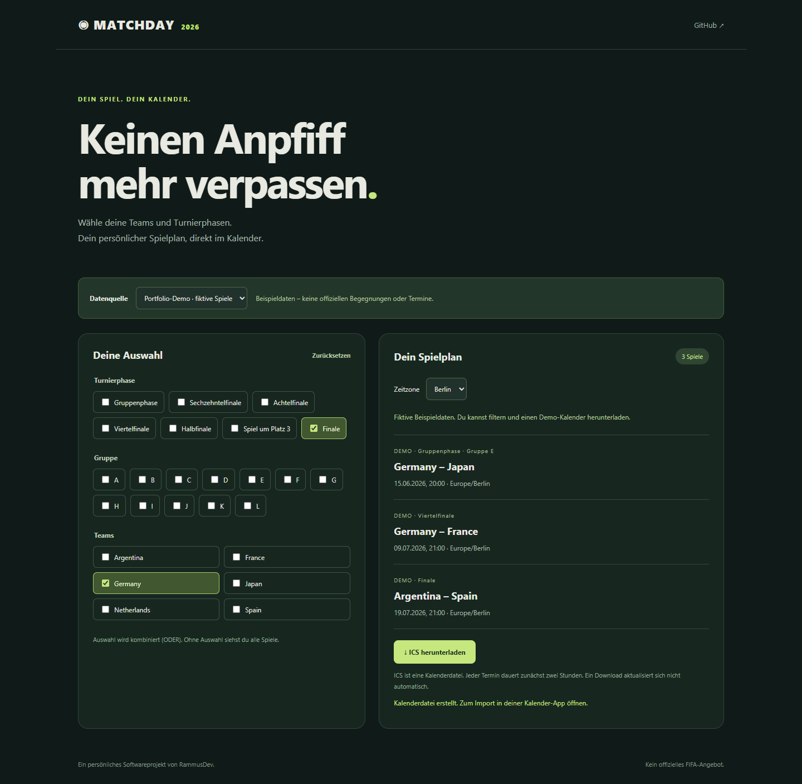

# Matchday · FIFA 2026 Calendar Tool

德文賽程工具：選擇球隊、小組與賽事階段，預覽自己的賽程並匯出 ICS 行事曆。



## 30 秒體驗

需要 Node.js 22 以上，無需安裝依賴。

```sh
npm start
```

開啟 http://localhost:8000，勾選 Germany 與 Finale，可看到聯集的三場示範比賽；按「ICS herunterladen」下載檔案並匯入行事曆。

預設四場資料是**虛構展示資料**，不是官方賽事或真實對戰。介面、檔名與事件說明都標示 DEMO。示範模式可在 GitHub Pages 等靜態主機直接運作，不依賴 Apps Script 或 Worker。

## 功能與設計

- 德文響應式介面、即時篩選預覽、Berlin／Taipei／UTC 顯示。
- 階段、小組、球隊採 OR 聯集，無選項則顯示全部；小組選項獨立運作，不被「全部小組賽」覆蓋。
- 網頁與 Worker 共用 `calendar.js` 的驗證、篩選及 ICS 產生邏輯。
- ICS 使用 UTC、穩定 UID、CRLF、文字跳脫及依 UTF-8 位元組計算的 75 octet 長行折行。事件固定兩小時。
- 外部資料失敗會顯示錯誤，Worker 回應 502；不會悄悄以示範資料替代真實賽程。
- 下載是單次匯入；訂閱是透過 Worker 定期讀取，更新頻率由行事曆 App 決定。

## 外部資料與訂閱

`config.js` 集中管理既有 Apps Script 資料來源及 Worker feed。切換「Externe Spieldaten」才讀取外部資料，成功後提供 webcal 訂閱與 HTTPS feed 複製。**本次未部署新版 Worker**，發布前應同步部署前端與 Worker，並實測訂閱。

每筆來源資料需包含：字串 id、round、team1、team2、帶時區的 time；group 與 memo 選填。id 必須唯一。round 可用 group、round32、round16、quarter、semi、third、final。資料來源負責賽事正確性，程式不推測官方對戰。

部署 Worker（需自己的 Cloudflare 帳號與 Wrangler）：

```sh
npx wrangler dev
npx wrangler deploy
```

可使用 Worker 環境變數 `DATA_URL` 覆寫來源。網頁需另外託管；將自己的部署 URL 更新到 config.js。Apps Script 來源處理程式不包含於 repository。

Feed 範例：`https://YOUR-WORKER.workers.dev/?team=Germany,Japan&stage=final`。

## 驗證

```sh
npm test
```

測試涵蓋 OR 篩選、全部／無結果、來源格式、重複 ID、ICS 跳脫／折行／UTC、Worker 正常與上游失敗。另以桌面與 390px 手機瀏覽器驗證預覽、下載及外部來源失敗後恢復示範模式。CI 使用 GitHub Actions。

本次未驗證外部來源的真實賽程、Cloudflare 正式部署或各家行事曆訂閱行為。

## 作品集介紹

> 實作德文賽程行事曆工具，以共用 JavaScript 模組連接前端預覽與 Cloudflare Worker，完成 OR 篩選、時區顯示及 ICS 相容性處理，並提供與外部服務隔離的示範資料及自動化測試。

[手機版畫面](docs/mobile.png)
